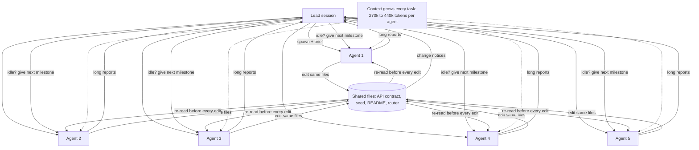
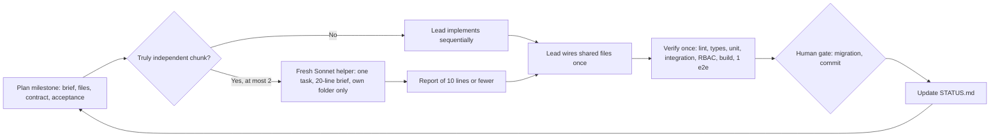
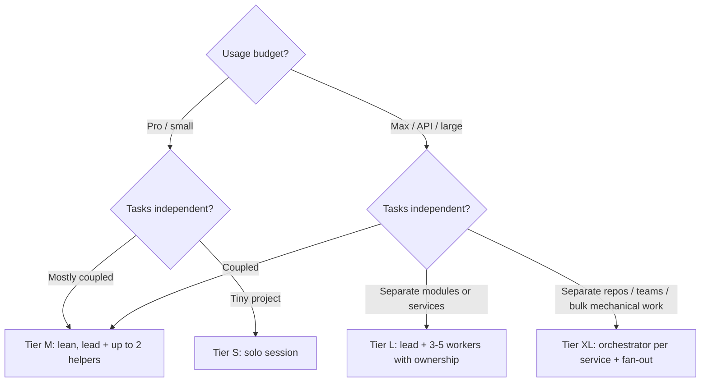

# AI-Assisted Development with Claude Code: Context Architecture & Multi-Agent Guide

*A field report from the HOK project, and a reusable template for solo developers and teams.*
Version 1.0 · 16 Oct 2026 · Project: HOK (House of Khalak) agency platform

---

## 1. Summary

- We built a two-repo product (API + web) with Claude Code. To go faster, we moved from one session to **five parallel helper agents** managed by a lead session, which gave each agent new work whenever it went idle.
- Within about **30 minutes of each run, the Claude Pro usage limit was exhausted**, twice. Work stopped mid-task each time.
- **Cause:** on a fixed usage budget, parallel agents don't add capacity; they spend it faster. Long-lived agents that were resumed again and again grew to **270k–440k tokens each**, and every step re-processed that history. Coordination overhead made the same work cost roughly 2–4× more.
- **What we did:** stopped all agents, wrote a handoff snapshot, cut the always-loaded context in half, and adopted a **lean workflow**: the lead works sequentially, with at most 2 short-lived helpers on a cheaper model, and verification once per milestone.
- **Main lesson:** match the agent setup to the **budget** and to **how independent the work really is**, not to how big the project feels.

---

## 2. The story: what happened

### 2.1 Context

| Item | Detail |
|---|---|
| Product | HOK: public portfolio website + agency management (clients, events, calendars, asset links, client portal, staff tasks, notifications) |
| Stack | Express + TypeScript API (modular monolith, Drizzle, Supabase), Next.js 16 web, local Docker Supabase |
| Size | 2 repos, about 12 business modules, 12 milestones (M0–M11) |
| Plan | Claude Pro, Claude Code in VS Code |
| Quality bar | Clean architecture per module, RBAC on every endpoint, tests (unit, integration, RBAC matrix, e2e), docs kept in sync |

### 2.2 Timeline

| When | What |
|---|---|
| Days 1–2 | Requirements, architecture and plan written with the lead session. Project context file (`CLAUDE.md`) created. M0 (setup) built solo. |
| Day 3 | **2 agents** (API + web), each owning one repo. Worked well, little conflict. |
| Day 4 | Grew to **5 agents** (API, screens, web, assets, tasks), 3 on Opus. Rule: *"when an agent is idle, give it the next milestone."* A coordination doc defined folders, ports and migration ranges. M0–M4 completed and verified. |
| Day 4, later | **Usage limit hit.** All 5 agents stopped mid-edit at the same moment. |
| Day 5 | Agents resumed, and the **limit was hit again within about 30 minutes**. Several side incidents surfaced (below). |
| Day 5 | All agents stopped. Snapshot written. Lean workflow adopted. |

### 2.3 Side incidents caused by parallelism

| Incident | Root cause |
|---|---|
| An agent registered a database schema in a shared file before creating it, which broke other agents' runs | Several agents editing shared wiring files |
| Lint went red in one agent's files while others were checking theirs | No single owner of "green" |
| A migration command applied **unapproved** migrations | `migration up` applies *all* pending files, and other agents had written theirs |
| One agent's migration failed (constraint name clash) during another's apply | Migrations written in parallel, applied together |
| Port clashes, orphaned dev servers, Playwright traces overwriting each other | Shared machine resources |
| The lead's own context bloated | Every agent edit produced a "file changed" notice for the lead |

### 2.4 What went right

- With clear folder ownership, the code itself was good. Every milestone passed its tests and checks.
- Infrastructure for parallel work held up: separate ports per agent, and separate build folders via `NEXT_DIST_DIR` so several web servers could run at once.
- Human approval gates (migrations, commits, Docker) held, apart from the bulk `migration up` problem.

---

## 3. Root-cause analysis: where the tokens went



| # | Cause | Effect |
|---|---|---|
| 1 | **Long-lived, resumed agents** | Each new task was appended to a growing history, and every tool call re-processes it. This was the biggest single cost. |
| 2 | **5 in parallel, 3 on the top model** | Five contexts burning at once at the highest price. |
| 3 | **Shared-file churn** | Constant re-reading of large shared files, plus change notices to the lead. |
| 4 | **Repeated heavy verification** | Full suites, browser e2e and screenshots (images are expensive) several times per milestone. |
| 5 | **Chatty coordination** | Long reports, relayed notes, resume messages, status checks. |

**The key economic point:** on a subscription with a fixed usage window, total useful work per window is roughly *budget ÷ cost per unit of work*. Parallelism doesn't raise the budget, and its overhead raises the cost per unit. The result is **less** work per window, plus idle time waiting for the reset.

---

## 4. Measures taken

| Measure | Purpose |
|---|---|
| Stopped all agents | Stop the burn |
| `docs/STATUS.md`: a snapshot of every agent's stopping point | Resume without re-exploring |
| `CLAUDE.md` cut from 134 to 72 lines; history moved to `docs/DECISIONS.md` | Less always-loaded context for every session and agent |
| `docs/WORKFLOW.md`: lean rules (below) | Prevent recurrence |
| Rule saved to the assistant's long-term memory | Future sessions follow it automatically |
| Model policy: Opus leads and reviews, Sonnet implements | Lower cost without lowering quality |

---

## 5. The lean workflow we adopted (WORKFLOW.md)



**The rules:**
1. **Default: the lead works alone**, milestone by milestone.
2. **Helpers only for truly independent chunks**, at most 2 at a time, on the cheaper model.
3. **Fresh, short-lived helpers.** One task, then they end. Never resume one for new work.
4. **Task brief, not exploration**: 20 lines or fewer, naming exact files, the contract, acceptance criteria and "read only these".
5. **Shared files belong to the lead**, wired once at the end.
6. **Verify once per milestone**; only targeted tests while working.
7. **Reports of 10 lines or fewer**: outcome, files, checks with counts, blockers.
8. **Approvals batched per milestone.** Only the lead applies migrations, one by one.
9. **Handoff = STATUS.md**, updated at each milestone end.
10. **The lead stays lean**: no polling, short replies, `/compact` or a new session between milestones.

### Model policy: does a cheaper helper model compromise quality?

| Work | Model | Why |
|---|---|---|
| Architecture, data model, security design (auth, RBAC, public endpoints, tokens), final review | **Top model (e.g. Opus)** | Judgment across many files; subtle risks |
| Well-specified implementation following an existing pattern, UI built from existing components, tests, docs, lint fixes | **Cheaper model (e.g. Sonnet)** | Strong at bounded, pattern-following work |
| Quality protection, whatever the model | **Automated gates + lead review** | Lint, typecheck, unit/integration tests, RBAC matrix, API-contract test, query budget, e2e |

---

## 6. Choosing a setup by project scale and budget



| Tier | Typical project | Budget | Setup | Avoid |
|---|---|---|---|---|
| **S: Solo** | Landing site, script, small app, 1 repo | Any | One session, no agents | Any agents (pure overhead) |
| **M: Lean** | Medium product like HOK: 1–2 repos, about 5–20 coupled modules | Pro | Lead (top model) + at most 2 fresh helpers (cheaper model) for independent chunks | Long-lived agents; more than 2 parallel |
| **L: Team** | Large app, many modules with clean boundaries | Max / API | Lead + 3–5 workers; strict ownership; one integrator owns shared files; fresh agent per task | Reassign-when-idle loops; shared-file edits by workers |
| **XL: Org** | Microservices, mobile + backend, many repos/teams; bulk refactors; research fan-out | Max 20× / API | One orchestrator per service/repo; fan-out of short workers for mechanical work | Cross-service agents; one giant context |

**Rule of thumb:** parallel agents pay off when **budget is large and tasks are independent**. If either is missing, sequential work finishes sooner in calendar time.

---

## 7. Template: context architecture for an AI-assisted codebase

### 7.1 The five context layers

| Layer | File(s) | Loaded | Size rule |
|---|---|---|---|
| **L0 Personal memory** | Assistant memory (user preferences, standing rules) | Every session | A few one-line facts |
| **L1 Constitution** | `CLAUDE.md` (root + one per repo) | Every session **and every agent** | 80 lines or fewer: rules, summary, pointers only |
| **L2 Reference** | `docs/REQUIREMENTS.md`, `docs/ARCHITECTURE.md`, `docs/adr/*`, `docs/engineering-practices.md`, skills | On demand | Any size; never auto-loaded |
| **L3 State** | `docs/STATUS.md` (handoff), `docs/DECISIONS.md` (log) | At session start / when deciding | STATUS: one page |
| **L4 Task** | Task brief per agent | Only for that agent | 20 lines or fewer |
| **Truth** | Code, tests, API contract (OpenAPI) | When needed | Always wins over docs |

**Principle:** store knowledge once, load only what the task needs.

### 7.2 Recommended repo layout

```
project/
├── CLAUDE.md                  # L1 constitution (≤80 lines)
├── docs/
│   ├── STATUS.md              # L3 handoff: milestone states, next actions
│   ├── DECISIONS.md           # L3 decision log + changelog
│   ├── WORKFLOW.md            # how humans + agents work here
│   ├── REQUIREMENTS.md        # L2
│   ├── ARCHITECTURE.md        # L2
│   └── adr/                   # L2 architecture decision records
├── .claude/skills/<name>/SKILL.md   # L2 rules loaded when relevant
├── api/ (CLAUDE.md, README.md, openapi.yaml, docs/)
└── web/ (CLAUDE.md, README.md, docs/)
```

### 7.3 `CLAUDE.md` skeleton

```markdown
# CLAUDE.md: <Project>
## 0. Working rules (hard)
- Ask before actions outside the project (apps, containers, processes, credentials, DB writes).
- Explicit "yes" before every commit/push. Never touch production unless asked.
- Allowed without asking: edit files, run lint/typecheck/tests/build locally.
## 1. What this is (5 lines)
## 2. Where things are
- Status: docs/STATUS.md · Decisions: docs/DECISIONS.md · Workflow: docs/WORKFLOW.md
- Requirements / Architecture / ADRs: docs/…
## 3. Stack + conventions (5–10 lines, link details)
```

### 7.4 `STATUS.md` skeleton

```markdown
# Status (updated <date>)
| Milestone | State | Evidence (checks + counts) |
## Database / environment state
## Open issues and blockers
## Next actions (ordered)
```

### 7.5 Task brief template (for a helper agent)

```markdown
Goal: <one sentence>
Read only: <3–6 files, incl. the module to copy as a pattern>
Own (may edit): <folders>   Do not edit: <shared files>
Contract: <endpoints / types / props>
Acceptance: <tests to add + commands that must pass>
Gates: write migrations but don't apply; no git; no servers left running
Report (≤10 lines): outcome · files · checks with counts · blockers
```

### 7.6 Report template

```markdown
Outcome: done | blocked | partial
Files: <list>
Checks: lint ✓ · typecheck ✓ · unit 182/182 · integration 58/58 · e2e 1/1
Needs approval: <migration / none>
Risks or follow-ups: <one line each>
```

### 7.7 Gates that protect quality regardless of model

- Lint + typecheck + unit tests on every change.
- Integration tests against a real local database.
- RBAC matrix: every endpoint × every role.
- API contract test (routes and enums must match the documentation).
- Query budget (no N+1, capped pages).
- One critical-path e2e per milestone.
- Human gates: migrations, commits, pushes, production.

---

## 8. Checklists

**Before spawning an agent**
- [ ] Is the chunk independent (own folder, no shared tables or screens in flight)?
- [ ] Is a cheaper model enough (pattern exists, no security design)?
- [ ] Is the brief 20 lines or fewer, with exact files and acceptance criteria?
- [ ] Are fewer than 2 helpers running (Tier M)?

**When an agent finishes**
- [ ] Review the report, spot-check the checks.
- [ ] Wire shared files once (lead).
- [ ] End the agent; don't reuse it.

**At milestone end**
- [ ] One full verification run.
- [ ] Batched human approval (migration + seed), then commit with explicit yes.
- [ ] Update STATUS.md; `/compact` or start a fresh session.

---

## 9. Lessons learned

1. **Agent count is not speed.** On a fixed budget, throughput comes from low cost per unit of work.
2. **Context grows silently.** Resuming the same agent for new work is the most expensive habit.
3. **Shared files are the real bottleneck** of parallel coding. Give them one owner.
4. **Bulk operations need human-aware design.** "Apply all pending" collided with per-item approvals.
5. **Keep the always-loaded context tiny**; link to everything else.
6. **A one-page STATUS.md** makes stopping and resuming cheap and safe.
7. **Use cheaper models for bounded work, top models for judgment**, with automated gates protecting quality.
8. **Measure by verified work delivered per usage window**, not by how many agents are busy.
